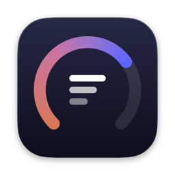
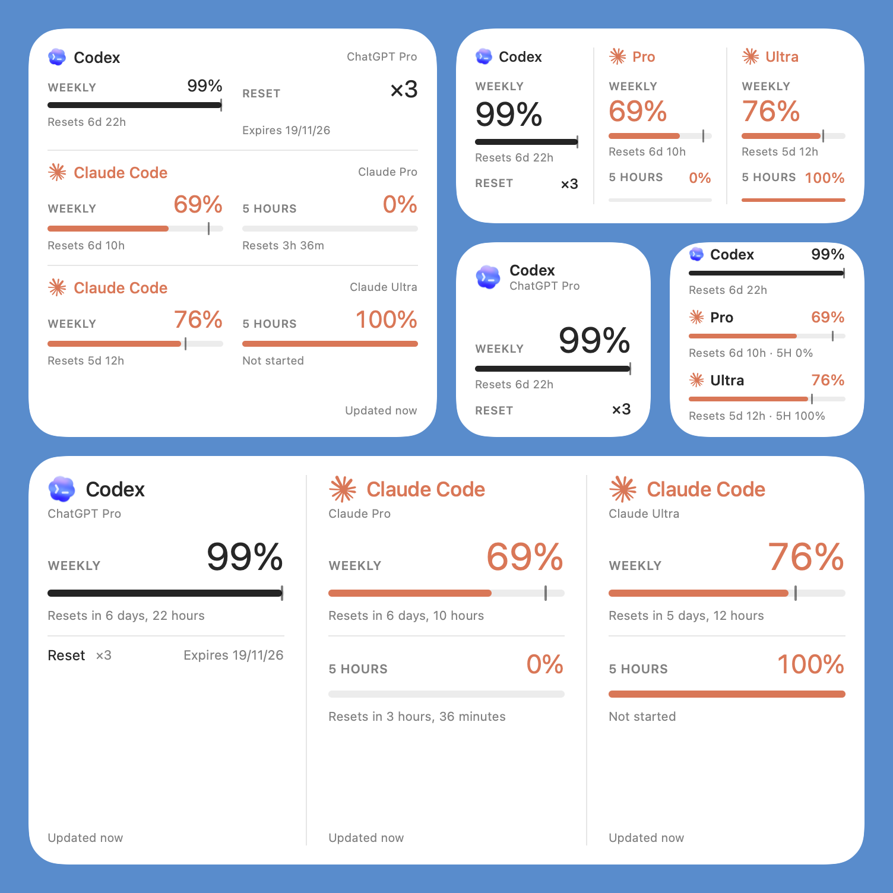
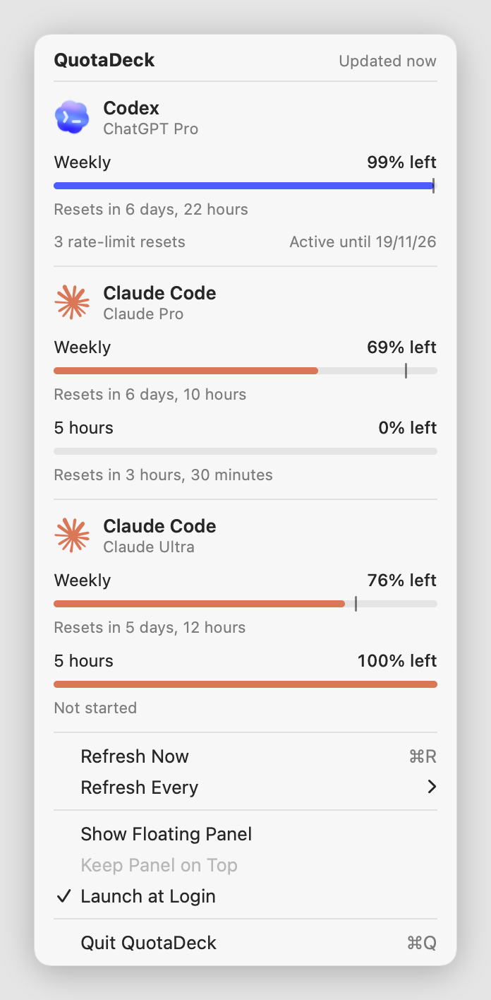
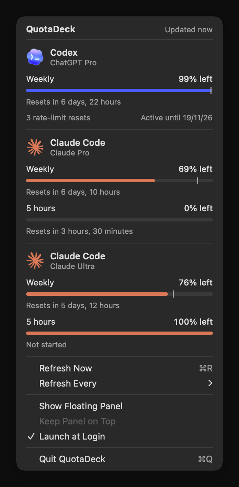
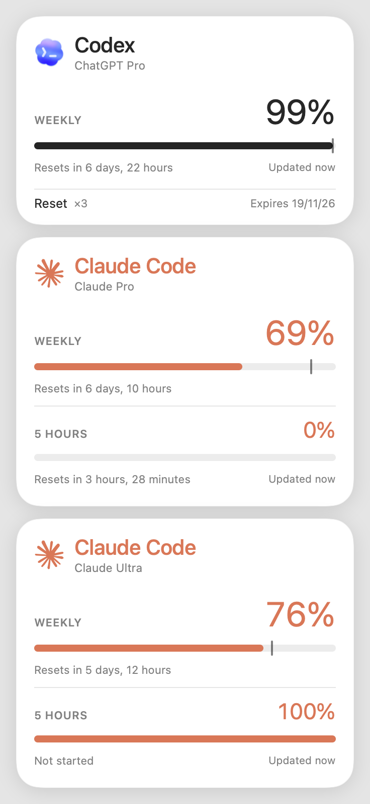
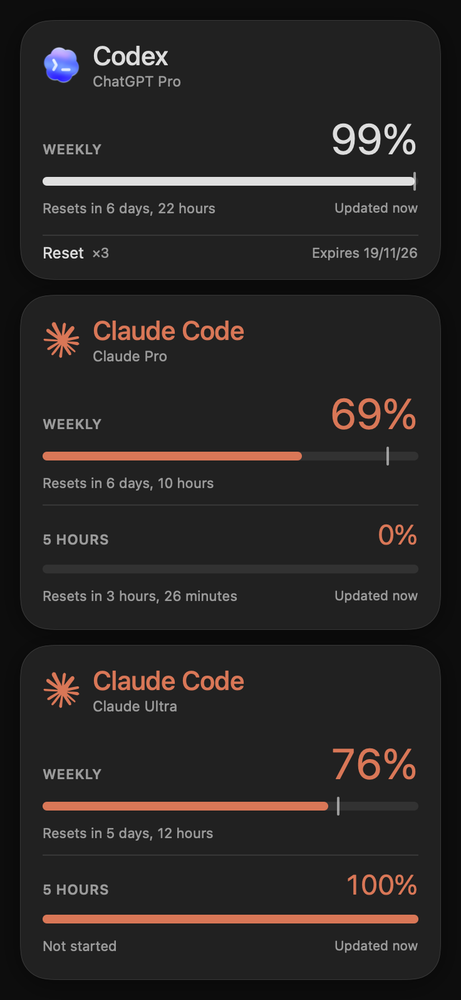

#  QuotaDeck

A native macOS widget and menu bar app that shows how much **Claude Code** and **Codex** quota you
have left, for every account on your Mac.

<p></p>

## Features

- **Real macOS widgets** (WidgetKit) for the desktop or Notification Center:
  - **QuotaDeck**: all accounts at once, in small, medium, large and extra large sizes.
  - **QuotaDeck Account**: one account in a small widget. You choose the account with *Edit Widget*.
- **Menu bar icon** with a native menu: remaining quota and reset time for each account.
- **Optional floating panel**, in light and dark mode.
- Weekly and 5-hour windows, plus a **pace marker** that shows whether you are using quota faster
  than a steady rate.
- Shows each account's **plan** (e.g. *Claude Max 20x*, *ChatGPT Pro*).
- Written in Swift with SwiftUI and AppKit. No dependencies and no CPU use while idle.

<p>
  
  
</p>

<details>
<summary>Floating panel</summary>
<p>
  
  
</p>
</details>

## Requirements

- macOS 14 (Sonoma) or later, Apple silicon
- At least one of:
  - **Codex CLI**, signed in (`~/.codex/auth.json`)
  - **Claude Code** accounts managed by [CLIProxyAPI](https://github.com/router-for-me/CLIProxyAPI)

## Installation

1. Download `QuotaDeck-<version>.zip` from the [latest release](https://github.com/IGOLz/quotadeck/releases/latest).
2. Unzip it and move `QuotaDeck.app` to your Applications folder.
3. Open it. QuotaDeck lives in the menu bar; it has no Dock icon.

The app is signed with a Developer ID and notarized by Apple.

### Build from source

Requires Xcode 16 or later (Swift 6 toolchain).

```sh
git clone https://github.com/IGOLz/quotadeck.git
cd quotadeck
./scripts/build.sh --install
```

This builds `QuotaDeck.app`, copies it to `~/Applications` and launches it.
Run `./scripts/build.sh` without `--install` to only build it into `build/`.
Local builds are ad-hoc signed, so they run on the Mac where you build them without an Apple
Developer account.

## Usage

**Menu bar.** Click the QuotaDeck icon to see every account. The menu also has:

- *Refresh Now* (⌘R)
- *Refresh Every*: 30 seconds, 1, 2 or 5 minutes (default: 1 minute)
- *Show Floating Panel* and *Keep Panel on Top*
- *Launch at Login*

**Widgets.**

1. Right-click the desktop and choose **Edit Widgets…**
2. Search for **QuotaDeck** and drag a widget where you want it.
3. For **QuotaDeck Account**, right-click the widget, choose **Edit Widget** and pick the account.
   Add one widget per account if you want them separate.

Clicking a widget opens the menu bar menu.

### Reading the numbers

- **Big percentage**: quota left in the window (weekly or 5 hours).
- **Vertical marker** (weekly only): where the bar would be at a steady pace. If the bar ends
  before the marker, you are using quota faster than that pace.
- **Reset ×N** (Codex): available rate-limit reset credits.
- **Expires** (Codex): when the ChatGPT subscription ends.
- **Orange "Updated…" text or dot**: the last refresh failed, or the data is more than 15 minutes old
  (for example, the app is closed). The last good values are still shown.

## How it works

| Provider | Where accounts come from | Endpoint |
|---|---|---|
| Codex | `~/.codex/auth.json`, `~/.codex-*/auth.json`, `$CODEX_HOME`, and `codex` accounts in CLIProxyAPI | `chatgpt.com/backend-api/wham/usage` |
| Claude Code | CLIProxyAPI auth files (`auth-dir` in `~/.config/cliproxyapi/config.yaml`, default `~/.config/cliproxyapi/auth/`) | `api.anthropic.com/api/oauth/usage` |

- The app reads tokens from disk on every refresh. It never refreshes or writes them; the Codex CLI
  and CLIProxyAPI keep them up to date.
- After each refresh, it writes `~/Library/Application Support/QuotaDeck/widget-snapshot.json`
  with percentages, dates, plans and emails only, **never tokens**.
- The widget extension is sandboxed and can only read that file.
- WidgetKit is asked to redraw at most once a minute. Between redraws the widget timeline advances
  every 2 minutes to keep countdowns accurate.

## Privacy

QuotaDeck talks only to Anthropic and OpenAI, using your own tokens, to read your usage. It has no
analytics or telemetry and runs no server.

## Disclaimer

QuotaDeck is an independent project. It is **not affiliated with, endorsed by or supported by
Anthropic or OpenAI**. Claude, Claude Code, Codex and ChatGPT are trademarks of their owners.

The usage endpoints QuotaDeck calls are the ones the Claude Code and Codex CLIs use internally. They
are **not public, documented APIs**: they may change or stop working at any time, and their use may
be subject to each provider's terms of service. Use QuotaDeck at your own risk.

## Development

```sh
swift build                    # debug build
./scripts/build.sh             # release app bundle in build/
```

`scripts/build.sh` packages the widget extension (`Contents/PlugIns/QuotaDeckWidget.appex`) and
generates its App Intents metadata, which Xcode would normally do.
`scripts/release.sh` builds the signed and notarized zip attached to GitHub releases (setup steps
are at the top of the script).

Render with real data without opening the UI, useful for screenshots:

```sh
build/QuotaDeck.app/Contents/MacOS/QuotaDeck --menu-snapshot out.png [--dark]    # menu bar menu
build/QuotaDeck.app/Contents/MacOS/QuotaDeck --snapshot out.png [--dark]         # floating panel
build/QuotaDeck.app/Contents/MacOS/QuotaDeck --widget-snapshot out.png [--dark]  # all widget sizes
```

Icon and logos: `scripts/assets/make-app-icon.swift` regenerates the app icon, and
`scripts/assets/extract-codex-logo.swift` extracts the Codex logo from ChatGPT.app.

## Contributing

Issues and pull requests are welcome. For larger changes, please open an issue first to discuss them.

## License

[MIT](LICENSE)
